<p align="center">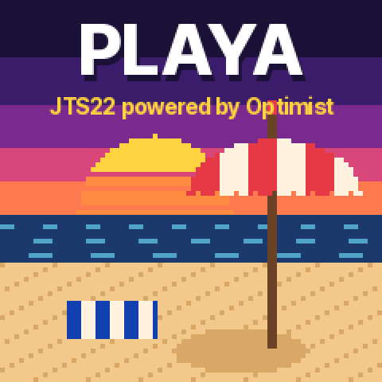</p>

<h1 align="center">PLAYA</h1>

<p align="center"><b>A performance-oriented firmware for the M-VAVE FM-1, based on Optimist.<br>
5 engines, 32 drum kits, 135 presets — all playable from one screen and controlled with knobs 1–4.</b></p>

<p align="center">JTS22 · created by JFS with help from Claude (Anthropic) · built on <a href="https://github.com/w0ts/optimist">Optimist</a> · GPL-3.0-only</p>

---

PLAYA turns the FM-1 into a live instrument: two synth layers on one keyboard (layered, split, crossfaded or single —
out of the box a Juno string pad layered with an FM electric piano, and an 808 kit),
a drum kit with a simple step sequencer, send effects, and a high-contrast interface where every panel button opens
one page and the four knobs always do what the screen shows.

It is **built on [Optimist](https://github.com/w0ts/optimist)** by w0ts and contributors (and the FM-1 projects
Optimist itself stands on: SLOOP, Felucca, Melodee, Clipper, X0X and others — see [LICENSING.md](LICENSING.md)). PLAYA
keeps Optimist's engines, effects, drums, storage, update loader and recovery, removes most of what a performance
does not need (the full step sequencer, sampling, SD card, Wi-Fi, macros…), and adds the layers, the split and the
new interface. Unofficial: not made, endorsed or supported by M-VAVE or by the Optimist authors.

<p align="center">
  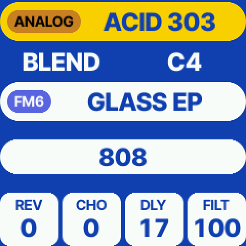
  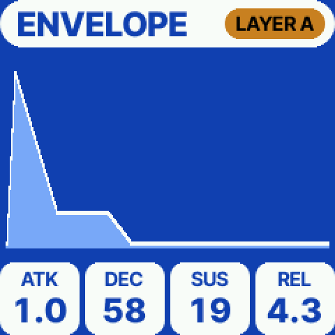
  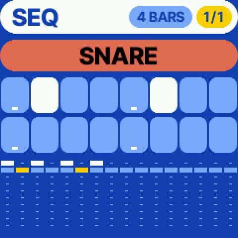
</p>

## What it does

- **Two layers on MIDI channel 1** (tracks 1 and 2), each with its own engine, sound, effects and level:
  **LAYER** (both everywhere), **SPLIT** (at a note), **BLEND** (an equal-power crossfade around the split, 0–24
  semitones, velocity untouched) and **SINGLE** (layer A alone). The FM-1's own keys play the layers too.
- **Engines:** PROPHET (Prophet-5 style, 8 voices), FM6 (DX7-compatible, with the KEYS, PADS, 80S, BELLS and BASS
  packs), ANALOG, DIGITAL and JUNO; 12 voices shared between the layers, the CPU guard protecting the audio.
- **Drums on MIDI channel 10** (GM note map), 32 kits, and a **drum step sequencer**: black keys pick the drum, white
  keys set the 16 steps, 4 to 16 bars, PLAY runs it.
- **Effects:** reverb, chorus and delay sends, a low-pass sweep per track, the master compressor and limiter.
- **One page a button**, knobs 1–4 always the four boxes or cards on screen, SELECT scrolls a page's screens, the
  page's button lit. ALGORITHM steps the engine (the kit on the drums).
- **External controllers:** eight knobs drive knobs 1–4, SELECT, PRESETS, ALGORITHM and the selected track's level;
  their CC numbers are editable on GLOBAL (default CC 70–77, an Akai MPK mini 3's K1–K8). Sustain, pitch bend and mod
  wheel reach both layers.
- **Bluetooth MIDI in both ways:** the FM-1 is a Bluetooth MIDI device, and it pairs with Bluetooth MIDI keyboards on
  its BLUETOOTH page (OCT− and OCT+ together).
- **Five colour themes:** PLAYA (default), BLUE, MONOCHROME, CREAM and ROLO.
- **Save / load** whole performances (both layers, split, effects, drums, theme, knob CCs) in the flash's slots; hold
  SAVE on an empty slot for a new one.
- **Hold GLO** for two seconds for the PLAYA screen and the credits.

<p align="center">
  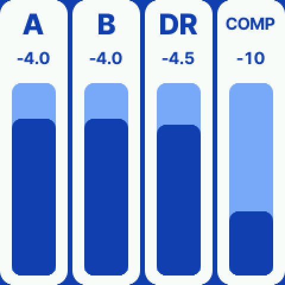
  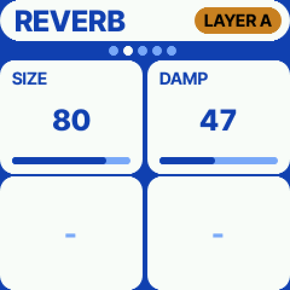
  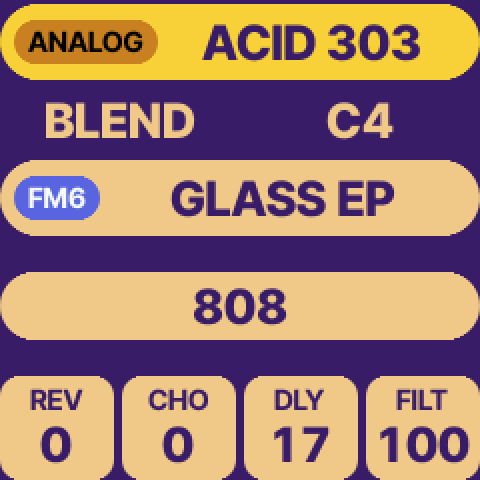
  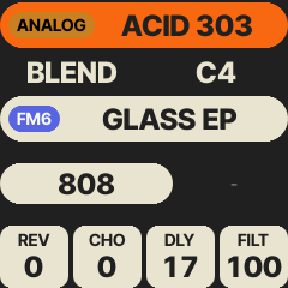
</p>

<p align="center">
  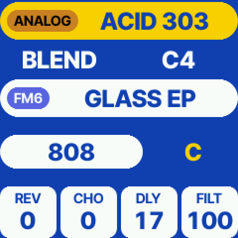
  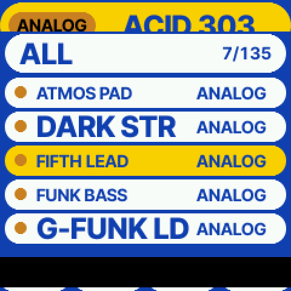
  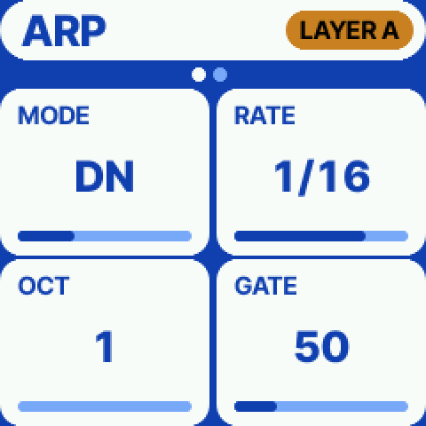
  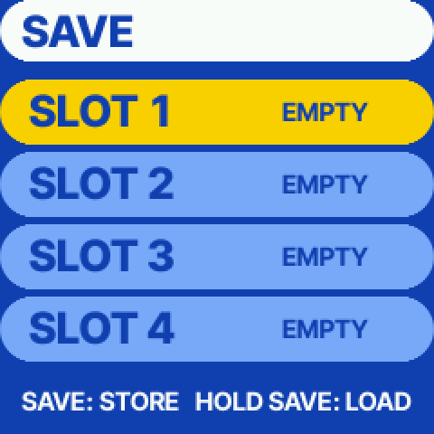
</p>

The manual is [docs/PLAYA-MANUAL.md](docs/PLAYA-MANUAL.md). The design spec is [docs/JTS22-SPEC.md](docs/JTS22-SPEC.md).

## Install

**Back up first.** PLAYA installs like any Optimist build (it is one): over USB-MIDI with Optimist's tools or web
installer. Installing over another firmware may erase the projects and user presets in flash.

```
make setup                                   # toolchain and SDK files (see BUILDING.md)
python3 tools/optimist.py package --classic --profile performance-v1 --out firmwares
python3 tools/optimist.py flash --classic firmwares/optimist-*-performance-v1.fwsc   # asks before it writes
```

PLAYA's packages identify as `FM-1_780` (version "PLAYA 0.1"). Or use the [Optimist web installer](https://w0ts.github.io/optimist/webapp/editor/#install) with the `.fwsc` file.
If an install is cut off, run it again; if the FM-1 no longer starts, hold **OCT−** while switching on (USB rescue)
and flash again, or go back to the official firmware ([docs/guide/getting-back.md](docs/guide/getting-back.md)).

## Build and test

PLAYA is Optimist's **classic** build with the `performance-v1` profile (builder item `PERF`):

```
make test                                    # Optimist's host tests (see the note below)
python3 tools/sim.py build --wasm --config config/profiles/performance-v1.config --out build/sim/perf.wasm
node tests/sim_perf_test.mjs                 # the layers, split, drums, pedal and knobs in the browser simulator
```

The PLAYA tests are `tests/perf_test.c` (layers, split gains, note ownership, voice budget, knobs, storage) and
`tests/sim_perf_test.mjs`. Every change was tried in the WebAssembly simulator before being flashed to a real FM-1.

**Known limits.** Optimist's release build, its release tests and its builder cost measurement need the private
`fm1base` submodule; without access only the classic build is available (that is what PLAYA ships), and
`tests/builder_test.py` reports the new `PERF` item as not measured. A few of Optimist's own host tests already fail
on this host without PLAYA's changes (`insend_test`, the automation CPU budget). The PROPHET engine and several
effects are marked by Optimist as tested in the host tests only; PLAYA has been played on one FM-1.

## What's where

PLAYA is Optimist's tree with a few files added and some changed; everything it adds is behind the builder item `PERF`.

| Path | What |
|---|---|
| `firmware/src/io/midi/perf.c` | the layers, LAYER / SPLIT / BLEND / SINGLE, the controller knobs (CC 70–76), the split's storage |
| `firmware/src/ui/optimist/op_perf.c` | the PLAYA pages: one a button, their banks, the buttons and encoders |
| `firmware/src/ui/optimist/op_perfdraw.c` | drawing PERFORM, MIX, the card pages, the ENV / LFO shapes, SAVE, the drum sequencer |
| `firmware/src/ui/optimist/perf_aa.c`, `perf_font.h` | the anti-aliased text and pills (Golana's renderer), the generated Inter Tight faces, the themes |
| `firmware/src/ui/splash.c` | the PLAYA boot screen (80 × 80 pixel art) |
| `config/profiles/performance-v1.config` | the PLAYA build: what is in, what is out |
| `tests/perf_test.c`, `tests/sim_perf_test.mjs` | PLAYA's host and simulator tests |
| `tools/gen_aa_font.py`, `tools/aa_raster.py`, `assets/fonts/` | making the fonts (from Golana; Inter Tight, SIL OFL) |
| `docs/PLAYA-MANUAL.md`, `docs/JTS22-SPEC.md`, `docs/img/` | the manual, the design spec, the pictures |
| everything else | Optimist, as upstream (its own README: `docs/OPTIMIST-README.md`) |

## Credits and licence

- **[Optimist](https://github.com/w0ts/optimist)** by w0ts and contributors: the firmware PLAYA is built on (upstream
  commit `e6d9f5d`), and everything it credits in turn ([LICENSING.md](LICENSING.md),
  [docs/OPTIMIST-README.md](docs/OPTIMIST-README.md)).
- **[Golana](https://github.com/Gadlele/Golana)** by Leo Kuroshita (Hügelton Instruments): the anti-aliased font tools
  and text renderer (`tools/gen_aa_font.py`, `tools/aa_raster.py`, `firmware/src/ui/optimist/perf_aa.c`).
- **Inter Tight** by The Inter Project Authors (SIL OFL 1.1): the interface's font.
- **Melodee** by Kerem Kilic: the PROPHET voice and the inspiration for PLAYA's voice budget.
- **PLAYA / JTS22**: created by **JFS** with help from **Claude** (Anthropic), November 2026.

Code: **GPL-3.0-only** ([LICENSE](LICENSE)), as Optimist; assets have their own terms ([LICENSING.md](LICENSING.md)).
No warranty. Each file PLAYA adds says so in its header; the Optimist files it changes carry `FELUCCA_PERF` / JTS22
comments where they were changed (2026-11-10). If you distribute a build, give its source under the same licence.
M-VAVE and FM-1 are trademarks of their owners; product names (Prophet-5, DX7, Juno, Roland) only say what an engine
or a colour scheme is inspired by.
